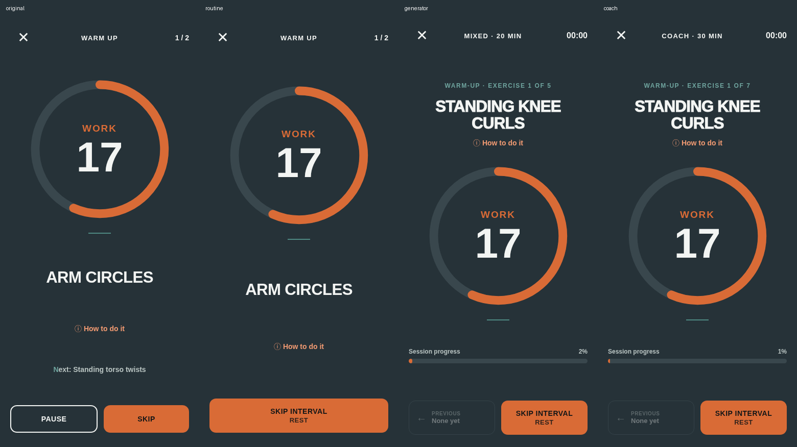
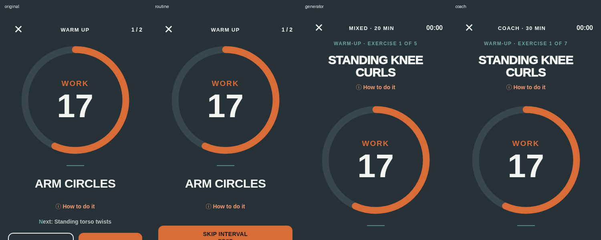

# Shared circular timer verification (#164)

Both players now use the original Prep & Recover `.ring-wrap`, SVG circles,
`.ring-center`, `.phase-label`, `.timer-num` and `.reps-num` styles. The canonical
72vw/330px size, short-height 60vh/280px rule, 200-unit SVG, radius 90, 12-unit
round-capped stroke, progress direction and 82px/900 tabular numerals are shared.
The button reset adds no padding, border or line-height changes. The generated
ring host reserves space for the original divider so it clears side/load labels. A fixed-size ring
can scroll with its player on short screens; it does not shrink independently.

Pause changes `aria-pressed`, the button's accessible action and an absolutely
positioned pause mark. It leaves the countdown/phase stack and phase colours in
place. Enter, Space, click and touch use the native button's single click handler.
Instructions, Coach inputs and the rest of the panel have no pause handler.
Untimed work shows its reps and a separate accessible pause control.

The routine clock remains `state.timer`; the generated player reads its existing
phase, EMOM-minute or density-cap clock. No clock, target, tracker record or
programme policy was added. Density continues to show the cap and explicit
recovery status; EMOM continues to show its minute window and work/rest status.

| Entry point | Player | Progression |
| --- | --- | --- |
| Prep & Recover Warm Up/Cool Down, bodyweight/equipment | `#player` | Get ready, timed work and any rest; Next skips the current interval |
| 7 Minute Workout | `#player` | Work/rest circuit |
| 5-Minute Ab Blast | `#player` through Workouts UI | Continuous timed sequence |
| Evening Full-Body Reset | `#player` through Workouts UI | Timed sequence with changeovers |
| Post-Run Reset | `#player` through Workouts UI | Fixed timed sequence with per-step transition rules |
| Legacy ramp-up and snack callable entry points | `#player` | Existing timed routines; covered without adding navigation links |
| Rep-based fixed-sequence support | `#player` through Workouts UI | Rep target/Next, then any timed work; no fabricated ring |
| 300 Workout, Cindy | `#workoutPlayer` | Reps/rounds or AMRAP; existing Previous and explicit rep completion |
| Generator | `#workoutPlayer` | Timed skip/partial evidence versus confirmed reps; existing Previous |
| Coach | `#workoutPlayer` | Same controls with actual-result inputs, durable saves, busy locks and feedback |

Routine playback has no occurrence replay/history-reconciliation contract. Adding
Previous would require new rules for already completed/skipped routine evidence,
so its supported navigation remains forward-only. EMOM minutes cannot be replayed;
density retains its recovery minimums and restrictions on revisiting ended blocks.

Every primary button previews only the immediate activity name. Side annotations,
timing, reps, resistance, set counts and after-rest explanations are excluded.
A timed final activity still says **Skip interval**, never falsely claiming
completion. Untimed final work and Coach feedback keep their distinct finish paths.

## Reproduce the mobile checks

The optional developer check uses installed Python Playwright, Pillow and Chromium;
none are application dependencies. Serve this checkout on port 8000 and an unchanged
checkout of commit `8a15253afde2b45645bbd0d5eb5062decceaaa32` on port 8001, each
bound to `127.0.0.1` and scoped to its own directory. Then run:

```sh
python scripts/verify-player-timers.py \
  --url http://127.0.0.1:8000 \
  --reference-url http://127.0.0.1:8001 \
  --output /tmp/player-timers
node --test tests/*.test.js
```

The browser check enters all six fixed workouts through their real detail/Start
buttons, both Prep & Recover cards, Generator and the real Coach programme/preview/
Start flow. It exercises native touch/click/Space/Enter pause/resume, focus outlines,
frozen clocks, instruction isolation, exit/cancel and rep-only pause controls.
Node regressions additionally cover automatic progression, timed skip versus
completion, cues, rest boundaries, Previous, Coach save/busy/failure and actuals.

Evidence uses Chromium at 390×844, 375×568 and 320×568 CSS pixels, with equivalent
30-second intervals showing 17 seconds. Full viewport screenshots retain each
player's surrounding layout. For pixel comparisons, the actual ring is moved to
the same screen coordinates and its surroundings are hidden, avoiding subpixel
screen-position and focus-outline differences. Its SVG, dimensions, typography,
phase stack and colours remain untouched. Bounding-box offsets are also compared
before isolation. Triple-digit countdowns are checked for pause stability.
Physical iOS/Safari and audio/wake-lock hardware were not available; their existing
application paths are retained.

## Side-by-side evidence

Each image reads left to right: unchanged original, updated routine player,
Generator, and a real Coach session. The work/rest/cool-down rings were reviewed
for diameter, stroke, cap shape, progress direction, typography and alignment.
Their phase/number stack has identical relative coordinates and rendered pixels;
pausing preserves those coordinates. The surrounding player layouts retain their
existing ordering. On short screens the action controls remain reachable by
scrolling, as checked by the browser script.

| State | iPhone portrait (390×844) | Short viewport (375×568) |
| --- | --- | --- |
| Work | [Screenshot](images/player-timers/390x844-work.png) | [Screenshot](images/player-timers/375x568-work.png) |
| Rest | [Screenshot](images/player-timers/390x844-rest.png) | [Screenshot](images/player-timers/375x568-rest.png) |
| Cool-down | [Screenshot](images/player-timers/390x844-cooldown.png) | [Screenshot](images/player-timers/375x568-cooldown.png) |




